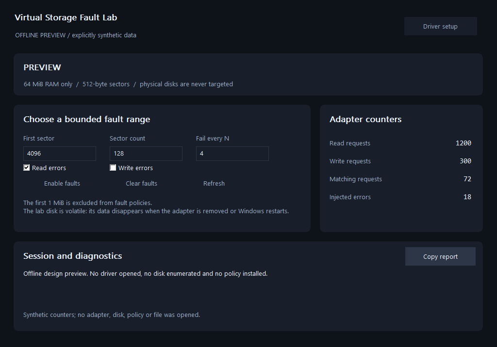

# Virtual Storage Fault Lab - Windows Kernel Virtual Disk & C++ SDK

**Test how Windows software handles storage I/O errors on a disposable RAM-backed disk.**

Create a repeatable failure scenario without touching a physical drive. The private Storport virtual miniport exposes one **64 MiB disk**, while the native app and two-file C++ SDK select a sector range and fail every Nth matching read or write in that range.



**Engineering preview for Windows x64.** Microsoft signing and deployment qualification are separate release gates. The public preview contains the application, SDK, examples and installer source; it contains no unsigned driver or nonfunctional setup executable. See [validation status](docs/VALIDATION.md) before planning deployment.

## What you can test

| Capability | Behavior |
| --- | --- |
| Real disk I/O | A kernel virtual storage adapter exposes a RAM-backed disk to the Windows storage stack. |
| Bounded failures | Select reads, writes or both; a sector range; and every Nth matching request. |
| Explainable results | Inspect read/write, matching, injected-error and rejected-request counters. |
| Safe targeting | The SDK opens only the adapter with the exact product hardware and service identity. It accepts no physical drive or arbitrary path argument. |
| Automatic recovery | A policy lease expires after 30 seconds without its owning client's heartbeat. The SDK renews it every five seconds and releases it at scope exit. |
| Native integration | Compile `SDK/StorageFault.cpp` with your program and include `SDK/StorageFault.h`. |

This is a storage QA component for developers of backup, synchronization, import/export, databases and other file-processing applications. It is not a physical-disk repair tool, filesystem protection product, persistent disk, benchmark or replacement for hardware fault qualification.

The first 1 MiB is excluded from fault ranges. Filesystem metadata can exist elsewhere, so an enabled rule can still make a mounted lab filesystem unusable. Use disposable fixtures. The application never formats a disk or opens a physical disk for reads or writes.

For completion metadata, pair the lab disk with [Storage I/O Flight Recorder](https://github.com/titanfyre/Storage-IO-Flight-Recorder). Attach that optional read-only filter while the lab disk is unpartitioned. Its timestamps describe its own read/write dispatch-to-completion boundary, rather than physical-media or application latency.

## Download and run

1. Download the complete Windows x64 ZIP from [Releases](https://github.com/titanfyre/Virtual-Storage-Fault-Lab/releases) and extract it.
2. Run **`StorageFaultLabApp.exe --preview`** for the labelled offline interface. No adapter is enumerated, disk opened or policy changed.
3. Live operation requires the matching Microsoft-signed driver. When its installable bundle is published, run **`StorageFaultLabSetup.exe`**, choose **Install / reinstall**, and restart only if setup asks. Console deployment uses **`StorageFaultLabSetupConsole.exe /install`** or **`/uninstall`**. Source-only setup builds have no payload and reject installation.
4. Open **`StorageFaultLabApp.exe` as administrator**. The app starts with faults disabled. Installing the virtual adapter exposes a volatile 64 MiB disk; partitioning/formatting it is a separate explicit lab operation.
5. Choose a range, a failure interval and read/write direction. Select **Enable faults** only for a disposable test workload on this product's disk.
6. Select **Clear faults** or close the application to release its policy. A crashed client loses its lease after 30 seconds. Uninstall removes only this product's adapter and package; the RAM disk's contents disappear.

`StorageFaultLabCLI.exe --status` prints actual adapter counters without claiming the policy. `--preview` prints explicitly synthetic data.

```powershell
# Fail every fourth matching read in sectors 4096..4223 for 30 seconds.
# This installs a fault policy, but does not issue disk reads or format anything.
.\StorageFaultLabCLI.exe --policy 4096 128 4 read 30
```

Use `write` or `both` only when that is part of your planned disposable test. Press Ctrl+C to clear the console session early.

## Minimal C++ integration

Build for Windows x64/C++17 and link `setupapi.lib`:

```cpp
#include "StorageFault.h"
#include <iostream>

int main() {
    try {
        StorageFault::Session lab;
        lab.Start();
        lab.SetPolicy(StorageFault::Policy(4096, 128, 4, SF_READ));
        std::cout << "Run the disposable workload, then press Enter.\n";
        std::cin.get();
    } catch (const std::exception& error) {
        std::cerr << error.what() << '\n';
        return 1;
    }
} // Scope exit clears the policy and stops its heartbeat.
```

`Policy(firstBlock, blockCount, every, flags)` requires a nonempty range inside `[2048, 131072)`, an interval from 1 to 1,000,000, and `SF_READ`, `SF_WRITE` or both. The policy affects only this product's synthetic disk. It does not select files or filesystem paths.

Matching counts the configured read/write commands whose validated transfer intersects the range. A transfer starting below sector 2048 is exempt. Every Nth matching command fails as a whole, not just the overlapping sectors. The matching sequence restarts when the policy changes or is cleared; the other counters accumulate for the adapter's lifetime. Windows may retry failed commands, so one failed miniport request does not promise one failed application call.

| API | Purpose |
| --- | --- |
| `Inspect()` | Read status without claiming a fault lease. |
| `Session::Start()` | Verify the adapter, claim its single-owner policy lease and start a bounded heartbeat worker. |
| `Session::SetPolicy(policy)` | Validate and atomically replace the active fault rule. A canonical disabled policy clears it. |
| `Session::Status()` | Read real counters, generation, current policy and remaining lease; renew ownership. |
| `Session::Stop()` / destructor | Stop the worker and release the policy. |
| `Session::LastHeartbeatError()` | Read an English heartbeat failure, if one occurred. |

Errors include the failing stage, an English explanation and the Windows error code. A lost lease is reported as an error; the SDK does not silently claim ownership again. Calls on one session are serialized; callers must stop using it before destruction.

## Build

Install Visual Studio 2022 Desktop C++ tools, CMake and a Windows SDK:

```powershell
.\Build.ps1
.\Build.ps1 -Asan
# Optional: build self-contained setup executables using an opaque signed package.
.\Build.ps1 -DriverPackageDirectory C:\Signed\TitanStorageFaultLab
```

Outputs are in `obj/Build/bin/Release`. The normal build and offline tests do not install a driver, create a disk or change Windows storage policy. The kernel implementation remains private; no WDK is required to build this public application.

```text
App/        Native UI and console
SDK/        StorageFault.h + StorageFault.cpp
Examples/   Minimal owned-policy example
Installer/  UI/console setup source, without a driver payload
Tests/      Offline protocol and boundary checks
docs/       Validation, operation and OEM integration
```

## OEM integration and support

For a **paid storage-error QA pilot, automated regression integration, a separately named driver, OEM redistribution rights or Windows compatibility maintenance**, add **`titancsa` on Discord**. Describe your workload, expected failure behavior, supported Windows builds and deployment volume. Agree acceptance tests and redistribution terms before production use; see [commercial integration](docs/COMMERCIAL.md).

The public application/SDK/example/installer source is [MIT licensed](LICENSE). The private driver has separate binary evaluation and commercial terms. This preview has no enforced timer, paid activation or online quota. A Microsoft signature is a deployment prerequisite, not a guarantee of correctness, compatibility, demand or revenue.

Use only for authorized testing on systems you own or administer. The software is provided AS IS under its applicable license. You remain responsible for your workloads, backups and compliance with applicable law.

Technical references: [Storport virtual miniport implementation](https://learn.microsoft.com/en-us/windows-hardware/drivers/storage/initialization-of-storage-virtual-miniport-drivers), [virtual miniport I/O](https://learn.microsoft.com/en-us/windows-hardware/drivers/ddi/storport/nc-storport-hw_startio), [storage design](https://learn.microsoft.com/en-us/windows-hardware/drivers/storage/).
